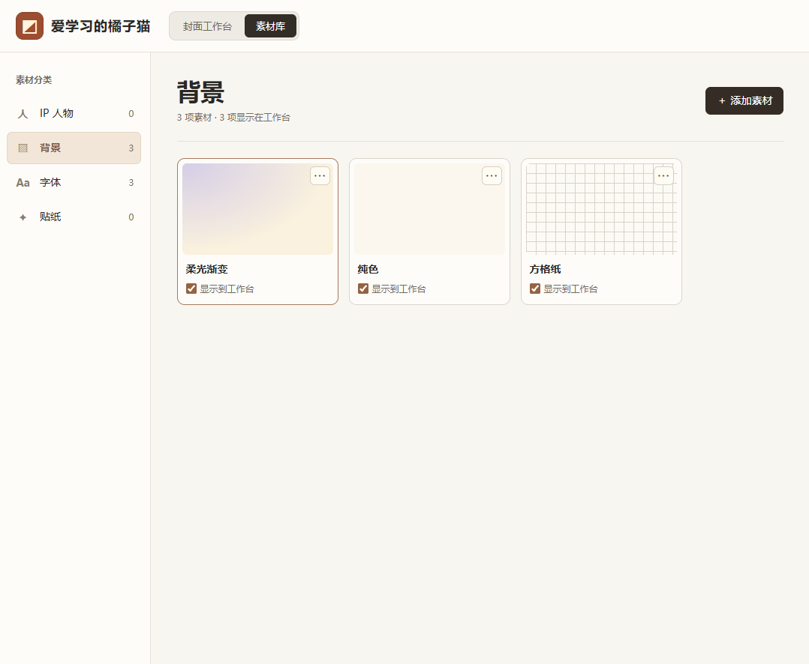

# 爱学习的橘子猫 · 封面工作台

`cover-workbench` 是一个在聊天里调用的 **AI 封面制作 Skill**。把标题、录屏或现成截图交给 Agent，它会选图、搭配你指定的 IP 人物，为四种画幅分别排出可编辑的初稿。打开随 Skill 提供的本地工作台，你就能直接拖动图层、换字体和调颜色。[安装方法](#安装)

## 在聊天里做第一张封面

装好 Skill 后，把本期录屏和人物图发到聊天里，可以直接说：

> 用封面工作台给这期视频做封面。标题是「用自己的素材做一张封面」，系列名用「AI工具 / 橘子猫封面skill推荐」。从录屏里挑一张能看清工作台的截图，人物用我刚发的这张。

Agent 会保留你给的文案，查看视频里的候选画面，挑出能说明标题的一至两帧。如果你已经指定截图，它会直接采用。接着，它把系列名和主标题放在上方，截图排在左侧，人物放在右侧，配上柔光渐变背景，再打开排好的草稿。文字、背景和每张图片都可以单独编辑。


例如，上图的标题用了手写体，你可以换成黑体或宋体。四种画幅独立编辑。例如，横版可以换一行标题、移动人物或删掉贴纸，竖版仍保留原来的样子。撤销和重做也只作用于正在编辑的画幅。

### 素材可以稍后补

只有标题也可以开始。告诉 Agent「截图和人物先跳过」，等拿到图片后，回到同一聊天说「把这张截图加到刚才的封面里」。它会把新图排进原草稿的四种画幅，保留你调过的标题位置。只想改一版时可以说「只把这张截图加到 16:9」。工作台显示「已同步」后，刷新就能看到补进来的图。

### 下期沿用自己的人物和素材

第一次可以在工作台右侧导入 IP 人物。新建封面时，如果素材库只有一个设为可见的人物，Skill 会自动沿用；有多个时，可以指定本期用哪一个。背景、字体和贴纸也能收藏，在「素材库」勾选想显示到工作台的项目，就能在对应图层中选用。



### 确认并取得 PNG

在工作台点「确认封面」，勾选这次需要的画幅，核对成品目录。回到聊天说「封面 OK」，Agent 就会导出所选 PNG，核对尺寸并把文件交给你。成品默认放在当前聊天的专属文件夹，也可按你指定的目录交付。

| 画幅 | 尺寸 |
| --- | --- |
| 小红书竖版 3:4 | 1080 × 1440 |
| B 站首页 4:3 | 1440 × 1080 |
| 个人空间 16:9 | 1920 × 1080 |
| 公众号主封面 2.35:1 | 1880 × 800 |

## 安装

把下面这句话发给支持 Skills 的 Agent：

> 请帮我安装封面工作台 Skill：https://github.com/Tangerine-Cat888/cover-workbench

也可以运行 `npx skills add Tangerine-Cat888/cover-workbench`，按提示选择宿主。已经下载仓库时，在仓库根目录运行 `npx skills add .` 即可。

本地运行需要 Python 3.10 或更高版本和 Pillow，导出 PNG 需要 Playwright 以及 Chromium 或 Edge。可在独立虚拟环境中运行以下命令。示例中的 `python` 指该环境的解释器。

```sh
python -m pip install -r requirements.txt
python -m playwright install chromium
```

从视频选帧还需本机能运行 FFmpeg 和 ffprobe。直接使用已有截图时可跳过这项安装。需要手动启动、恢复草稿或指定成品目录时，见[工作台操作说明](references/workbench.md)。

## 配置、数据与兼容性

工作台只监听本机回环地址。草稿目录里的一个 `cover.json` 保存四种画幅，自动保存会更新这一个文件。图片和字体放在同目录的 `assets/`，相同素材在同一草稿中只存一份。草稿目录建议选在仓库之外。跨封面复用的收藏位于用户数据目录。升级 Skill 后可以继续使用个人收藏。用 `COVER_WORKBENCH_DATA_DIR` 可另选位置。每个用户从空的人物与贴纸库开始。

导入的图片、字体和导出的成品均在本机处理。可选人物抠图初次需要联网下载模型和运行依赖，安装后在本机推理。运行依赖和浏览器准备完毕后，封面编辑与出图可离线使用。宿主需能执行本地程序并打开本机网页，也可直接在终端和浏览器使用。Windows 已做实机检查；macOS 和 Linux 的实际界面与导出待验证。

## 许可

原创程序和文档按 [MIT](LICENSE) 授权。作者 **Tangerine.Cat**。用户导入的图片、字体及其他素材继续适用各自的授权。依赖与模型来源见[第三方说明](references/THIRD_PARTY_NOTICES.md)。
